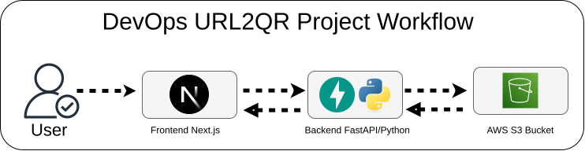

This project focuses on creating a streamlined solution for generating QR codes from user-provided URLs. It features a user-friendly `Next.js` front end for URL input, a robust `FastAPI` backend for QR code generation, and a secure storage system for saving the generated codes.

- `Front-End Container:` User-facing website for URL input.
- `API Container:` Backend service for QR code generation.
- `Storage Container:` Secure storage for generated QR codes.

## Branches

| Branch | Description |
|--------|-------------|
| `main` (default) | Contains the application code with DevOps practices implementation |
| `devops` | Contains the DevOps practices implementation code as well |

## Cloud & DevOps Practices

- **`Docker`**: Used for containerizing the front-end (Next.js) and API (FastAPI) to ensure consistent deployment across environments.

- **`GitHub Actions`**: Implements CI/CD pipelines to automate the deployment of containers when source code changes occur.

- **`Terraform`**: Manages and provisions cloud infrastructure, specifically creating a Kubernetes cluster using Infrastructure as Code (IaC).

- **`Kubernetes`**: Orchestrates the deployment and management of containerized applications, ensuring scalability and high availability.
  - **`KIND(Kubernetes in Docker)`** Deploying application to test the functionality localy using Kind Cluster. 
  - **`AWS EKS`**: Deploying the application on prodcution using AWS EKS cluster. 

- **`AWS S3`**: Provides secure storage for generated QR codes, allowing for persistent data storage and easy accessibility.

- **`Prometheus`**: Monitors container and system metrics, offering real-time insights for performance and operational monitoring.

- **`Grafana`**: Visualizes metrics collected from Prometheus and other sources, enhancing observability and aiding in performance monitoring and troubleshooting.

## Project Workflow

<div align="center">
  
</div>

## End to End CI/CD Pipeline


## Quick Start with Docker 

This is the fastest way to get the application running on your local machine.

### Prerequisites

- Docker Desktop / Docker Daemon installed on your machine
- Git (to clone the repository)

### Steps to Run with Docker

1. **Clone the repository**
   ```bash
   git clone <repository-url>
   cd DevOps-URL2QR
   ```

2. **First-time setup**
   ```bash
   docker compose up --build
   ```
   This command will:
   - Build all container images
   - Create necessary networks
   - Start all services
   - The frontend will be available at http://localhost:3000
   - The backend API will be available at http://localhost:8000

3. **Subsequent runs**
   ```bash
   docker compose up
   ```
   Use this command when you haven't made any changes to the Dockerfile or dependencies.

4. **Stop the application**
   ```bash
   docker compose down
   ```
   This will stop and remove all containers, but preserve your images.

### Additional Docker Commands

- To view logs of a specific service:
  ```bash
  docker compose logs frontend  # For frontend logs
  docker compose logs backend   # For backend logs
  ```

- To rebuild a specific service:
  ```bash
  docker compose up --build frontend  # Rebuild frontend only
  docker compose up --build backend   # Rebuild backend only
  ```

- To remove all containers and images (clean slate):
  ```bash
  docker compose down --rmi all
  ```

### Troubleshooting

- If you see connection errors, ensure all services are up:
  ```bash
  docker compose ps
  ```

- If the frontend can't connect to the backend, check the logs:
  ```bash
  docker compose logs backend
  ```

## Running the project locally

### Run the Backend

The Backend code exists in the `api` directory. You can run the API server locally:

1. Clone this repo

```bash
git clone <repository-url>
```

2. Make sure you are in the `api` directory

```bash
cd api
```

3. Create a virtualenv by typing in the following command:

```bash
python -m venv .venv
```

4. Install the required packages:

```bash
pip install -r requirements.txt
```

5. Create a `.env` file, and add your AWS Access and Secret key, check `.env.example` just run the below command

```bash
cp .env.example .env
```

6. Also, change the BUCKET_NAME to your S3 bucket name in `main.py`
7. Run the API server:

```bash
uvicorn main:app --reload
```

8. Your API Server should be running on port
   [ `http://localhost:8000`](http://localhost:8000)

### Run the Front-end

The front-end code exits in the `front-end-nextjs` directory. You can run the front-end server locally:

1. Make sure you are in the `front-end-nextjs` directory

```bash
cd front-end-nextjs
```

2. Install the dependencies:

```bash
npm install
```

3. Run the NextJS Server:

```bash
npm run dev
```

4. Your Front-end Server should be running on [`http://localhost:3000`](`http://localhost:3000`)

## This project is inpired by

[Rishab Kumar](https://github.com/rishabkumar7)

## Star 🌟 the project

If you like this project so far don't forget to star 🤩 the project for future reference.

## License

[MIT](./LICENSE)
